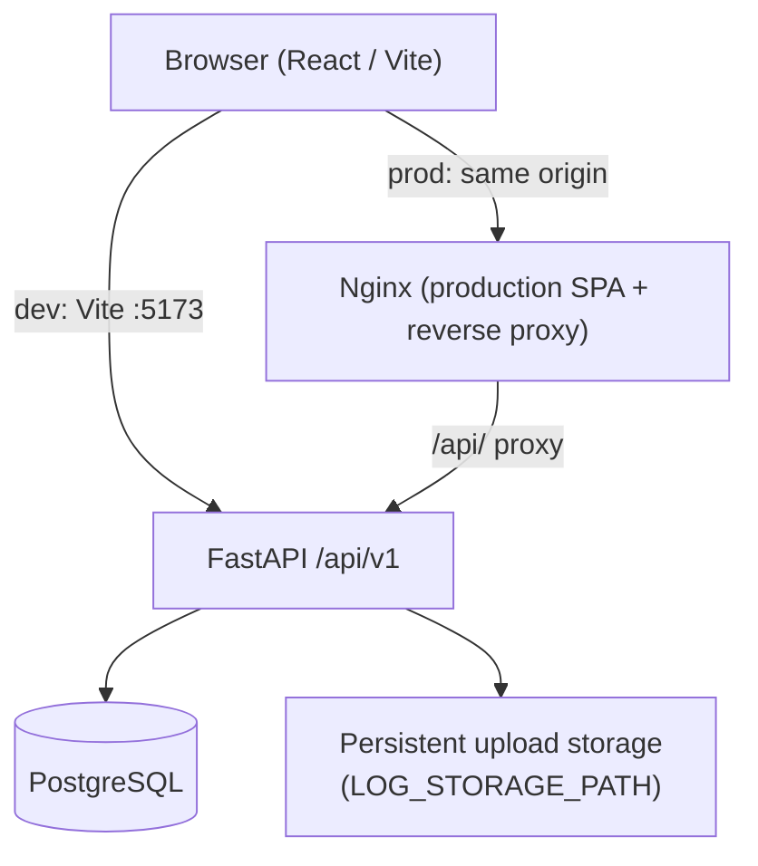
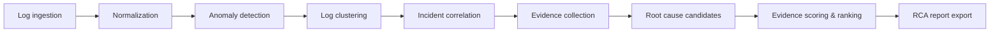

# PulseTrace

PulseTrace is a full-stack **observability and incident investigation** application. It ingests application logs, detects anomalies, groups similar errors, correlates events into incidents, and runs **evidence-based root cause analysis (RCA)** with ranked hypotheses and Markdown export—without requiring an LLM.

Built as a portfolio-grade **modular monolith**: React SPA, FastAPI API, PostgreSQL, filesystem upload storage, Docker packaging, and automated tests (pytest, Vitest, Playwright). **No public cloud deployment is claimed** from this repository; production-style verification uses local Docker Compose.

---

## Problem statement

On-call engineers often have **logs but not a structured path** from raw lines to answers: what changed, what broke, and what to verify next. General-purpose dashboards stop at charts. PulseTrace focuses on a narrow, defensible workflow you can explain in an interview: normalize → detect → correlate → investigate with **explicit supporting and contradicting evidence**, not opaque probability scores.

## Why PulseTrace is useful

- **Closed loop** from upload through RCA report in one product surface.
- **Honest ML/statistics**: z-score rules, Isolation Forest, TF-IDF + DBSCAN—each with documented limits.
- **Multi-tenant by project**: JWT auth and owner checks on every sensitive API.
- **Runnable demo** (ShopFlow) seeded through the real ingestion pipeline.
- **Tested**: 66 backend, 16 frontend unit, 27 Playwright E2E tests (verified locally; see [Testing and CI](#testing-and-ci)).

---

## Core features

| Area | What you get |
|------|----------------|
| **Projects & auth** | Registration, JWT + HttpOnly cookie, project ownership isolation |
| **Log ingestion** | CSV, JSON, JSONL, TXT; streaming to configurable **filesystem** storage |
| **Log explorer** | Search, filters, pagination, batch detail |
| **Anomaly detection** | Time-bucket features; z-score rules + optional Isolation Forest |
| **Clustering** | TF-IDF + DBSCAN on normalized messages (lexical similarity) |
| **Incidents** | Heuristic correlation, timelines, notes, resolve/reopen, deployment context |
| **RCA** | Candidate generation, evidence scoring, contradiction penalties, JSON/Markdown export |
| **Operations** | Dockerfiles, compose stacks, isolated prod QA compose, security middleware |

**Not implemented:** S3 object storage (`LOG_STORAGE_BACKEND=s3` is reserved only). **Scores are evidence strength (0–100), not calibrated probabilities.**

---

## Architecture



### Processing pipeline



Module boundaries live under `backend/app/modules/` (`logs`, `analysis`, `anomaly_detection`, `clustering`, `incidents`, `root_cause`). Deeper design: [docs/architecture.md](docs/architecture.md).

---

## Technology stack

| Layer | Technologies |
|-------|----------------|
| Frontend | React 18, TypeScript, Vite, Tailwind CSS, React Router, TanStack Query, Recharts |
| Backend | Python 3.10+, FastAPI, Pydantic, SQLAlchemy 2.0, Alembic, PyJWT, Argon2 |
| Database | PostgreSQL 16 (Docker Compose; default host port **5433** in `.env.example`) |
| ML / stats | scikit-learn (Isolation Forest), pandas/numpy |
| Testing | pytest, Vitest, React Testing Library, Playwright |
| CI | GitHub Actions (`.github/workflows/ci.yml`) — **configured locally; first GitHub run pending** |

---

## How anomaly detection works

1. **Ingestion** stores rows with levels, timestamps, fingerprints, optional service linkage.
2. **Feature extraction** builds configurable time buckets per project/service (counts, error ratios, unique fingerprints).
3. **Statistical rules** compare buckets to baselines (z-score, minimum samples); anomalies store JSONB **evidence** (measurements).
4. **Isolation Forest** (when enough samples exist) runs on scaled numeric features; limits via `ANALYSIS_*` env vars.

## Incident correlation

Heuristics only (documented in code and UI):

- Temporal overlap within configurable windows
- Shared services and **dependency graph** edges
- Cluster membership overlap
- Deduplication to limit incident sprawl

Deployments appear as **temporal context**, not proof of causation.

## Evidence-based RCA

1. Collect incident context (anomalies, evidence, deployments, dependencies, log samples within caps).
2. Generate typed candidates (e.g. deployment regression, service failure).
3. Score weighted evidence dimensions; **contradictions** apply penalties.
4. Rank by composite **evidence strength** (not probability).
5. Export investigation report (JSON + Markdown).

Optional Ollama narrative is **off by default** (`RCA_OLLAMA_ENABLED=false`).

---

## Database design (overview)

Relational core with JSONB for flexible evidence payloads.

| Entity | Role |
|--------|------|
| `users` | Authentication identity |
| `projects` | Owner-scoped workspace |
| `services`, `service_dependencies` | Topology for correlation |
| `log_batches`, `logs` | Ingested log data |
| `anomalies` | Detection results + evidence JSONB |
| `log_clusters` | DBSCAN groups |
| `incidents`, `incident_events`, `incident_evidence` | Correlated incidents |
| `deployments` | Timeline context |
| `rca_investigations`, `root_cause_candidates` | RCA runs and ranked hypotheses |

**Alembic head:** `d7e8f9a0b1c2`. Migrations: `backend/alembic/versions/`.

---

## Authentication and security

- **Argon2** password hashing; **JWT** access tokens; **HttpOnly** cookie for browser clients.
- Project-scoped authorization (`get_owned_project`) on sensitive routes.
- Production validation, rate limiting (in-process), CSRF Origin check for cookie auth, security headers, upload validation.

Details: [docs/SECURITY.md](docs/SECURITY.md) · [docs/SECURITY_AUDIT.md](docs/SECURITY_AUDIT.md)

---

## Docker setup

| File | Purpose |
|------|---------|
| `docker-compose.yml` | Local **PostgreSQL** only (dev API/SPA on host) |
| `docker-compose.prod.yml` | API + nginx frontend + Postgres + upload volume |
| `docker-compose.prod.qa.yml` | **Isolated** QA stack (ports 5434/8001/8081); env from `deploy/pulsetrace-prod-qa.env` (gitignored template: `.example`) |

```powershell
# Dev database
docker compose up -d

# Production-oriented stack
docker compose -f docker-compose.prod.yml up --build
```

Do **not** run `docker compose down -v` if you need to preserve volumes. Verification notes: [docs/PRODUCTION_DOCKER_VERIFICATION.md](docs/PRODUCTION_DOCKER_VERIFICATION.md).

Uploads persist on **filesystem** only; S3 is **not** implemented.

---

## Local development

### Prerequisites

- Node.js 20+, Python 3.10+, Docker Desktop (for Postgres)

### Environment

```powershell
Copy-Item .env.example .env
# Edit POSTGRES_PASSWORD, JWT_SECRET_KEY, DATABASE_URL (port 5433 default on Windows)
```

Never commit `.env`.

### Database and API

```powershell
docker compose up -d
cd backend
pip install -r requirements.txt   # or use existing .venv
alembic upgrade head
uvicorn app.main:app --reload --host 0.0.0.0 --port 8000
```

Health: `http://127.0.0.1:8000/api/v1/health/database`

### Frontend

```powershell
cd frontend
npm install
npm run dev
```

Open `http://127.0.0.1:5173`.

---

## Demo instructions (ShopFlow)

Synthetic **ShopFlow** data is seeded through the **real ingestion pipeline** (not fabricated SQL rows):

```powershell
cd backend
.\.venv\Scripts\python.exe ..\scripts\seed_demo.py --create-demo-user --password "YourSecurePass1!"
```

Walkthrough: [docs/DEMO_WALKTHROUGH.md](docs/DEMO_WALKTHROUGH.md).

Suggested demo flow: sign in → open ShopFlow → run analysis → correlate → open incident → **Run RCA** → export Markdown.

---

## Testing and CI

| Suite | Count (local, verified) | Command |
|-------|-------------------------|---------|
| Backend pytest | **66** | `cd backend && pytest -q` |
| Frontend Vitest | **16** | `cd frontend && npm test -- --run` |
| Production build | — | `cd frontend && npm run build` |
| Playwright E2E | **27** (+ **2** prod-docker when QA stack up) | `cd frontend && npm run test:e2e` |

For a **full local Playwright run**, start the API with `APP_ENV=test` (disables in-process auth rate limits, matching CI). See [docs/TESTING_GUIDE.md](docs/TESTING_GUIDE.md).

### GitHub Actions

Workflow: [.github/workflows/ci.yml](.github/workflows/ci.yml)

| Job | Runs |
|-----|------|
| `backend` | Postgres service → Alembic → pytest |
| `frontend` | `npm ci` → Vitest → production build |
| `Playwright E2E` | Separate DB `pulsetrace_e2e` → uvicorn → Playwright (Chromium), artifacts on failure |

**Status:** CI is **configured and validated locally** (YAML + project scripts). A **green badge on GitHub is pending** until you push and inspect the first workflow run.

---

## Screenshots

Captured from real E2E runs (committed under `docs/screenshots/`):

| Screen | Path |
|--------|------|
| Dashboard / overview | [docs/screenshots/e2e/dashboard.png](docs/screenshots/e2e/dashboard.png) |
| Projects | [docs/screenshots/e2e/dashboard-projects-list.png](docs/screenshots/e2e/dashboard-projects-list.png) |
| Incident explorer | [docs/screenshots/e2e/incident-explorer.png](docs/screenshots/e2e/incident-explorer.png) |
| Incident detail | [docs/screenshots/e2e/incident-detail.png](docs/screenshots/e2e/incident-detail.png) |
| RCA candidates | [docs/screenshots/e2e/rca-candidates.png](docs/screenshots/e2e/rca-candidates.png) |
| RCA evidence | [docs/screenshots/e2e/rca-evidence.png](docs/screenshots/e2e/rca-evidence.png) |
| Investigation report | [docs/screenshots/e2e/investigation-report.png](docs/screenshots/e2e/investigation-report.png) |

More: [docs/screenshots/e2e/README.md](docs/screenshots/e2e/README.md)

---

## Repository structure

```text
pulsetrace/
├── .github/workflows/ci.yml   # GitHub Actions
├── backend/
│   ├── alembic/               # Migrations
│   ├── app/                   # FastAPI application
│   ├── tests/                 # pytest
│   ├── Dockerfile
│   └── requirements.txt
├── frontend/
│   ├── e2e/                   # Playwright specs
│   ├── src/                   # React SPA
│   ├── nginx.conf             # Production reverse proxy
│   └── package.json
├── deploy/                    # QA env template (secrets gitignored)
├── docs/                      # Architecture, security, testing, audits
├── scripts/                   # seed_demo, backup, QA helpers
├── data/samples/              # Sample log fixtures (.gitkeep)
├── docker-compose.yml
├── docker-compose.prod.yml
├── docker-compose.prod.qa.yml
└── .env.example               # Publishable template (not secrets)
```

---

## Known limitations

- Synchronous analysis, correlation, and RCA in HTTP requests (env caps: `ANALYSIS_MAX_LOGS`, etc.).
- In-memory rate limiting (single instance; disabled when `APP_ENV=test`).
- JWT not revoked server-side until expiry.
- Filesystem uploads only (S3 not built).
- RCA rankings are heuristic evidence strength, not ML-calibrated probabilities.
- No hosted HTTPS or public cloud URL from this repo.

Full list: [docs/KNOWN_LIMITATIONS.md](docs/KNOWN_LIMITATIONS.md)

## Future improvements

- Background job queue for heavy analysis paths
- Implemented object storage backend (today: env flag only)
- Distributed rate limiting and token revocation
- TLS-terminated deployment guide with verified `AUTH_COOKIE_SECURE`

---

## Documentation index

| Document | Purpose |
|----------|---------|
| [docs/architecture.md](docs/architecture.md) | Phase-by-phase design |
| [docs/API.md](docs/API.md) | REST overview |
| [docs/DEPLOYMENT.md](docs/DEPLOYMENT.md) | Deploy preparation (no fake URLs) |
| [docs/TESTING_GUIDE.md](docs/TESTING_GUIDE.md) | pytest, Vitest, Playwright, CI |
| [docs/FINAL_RELEASE_AUDIT.md](docs/FINAL_RELEASE_AUDIT.md) | Release verification matrix |
| [docs/PORTFOLIO_AND_INTERVIEW_GUIDE.md](docs/PORTFOLIO_AND_INTERVIEW_GUIDE.md) | Resume and interview prep |
| [docs/INTERVIEW_READINESS.md](docs/INTERVIEW_READINESS.md) | Rehearsal checklist |

---

## API quick reference

Base URL (dev): `http://127.0.0.1:8000`

```http
POST /api/v1/auth/register
POST /api/v1/auth/login
POST /api/v1/projects/{id}/logs/upload
POST /api/v1/projects/{id}/analysis/run
POST /api/v1/projects/{id}/incidents/correlate
POST /api/v1/projects/{id}/incidents/{incident_id}/investigate
GET  /api/v1/projects/{id}/incidents/{incident_id}/investigation-report.md
```

OpenAPI UI (development only): `/docs`

---

## License

Add a `LICENSE` file before public release if you intend open-source distribution (none bundled yet).
