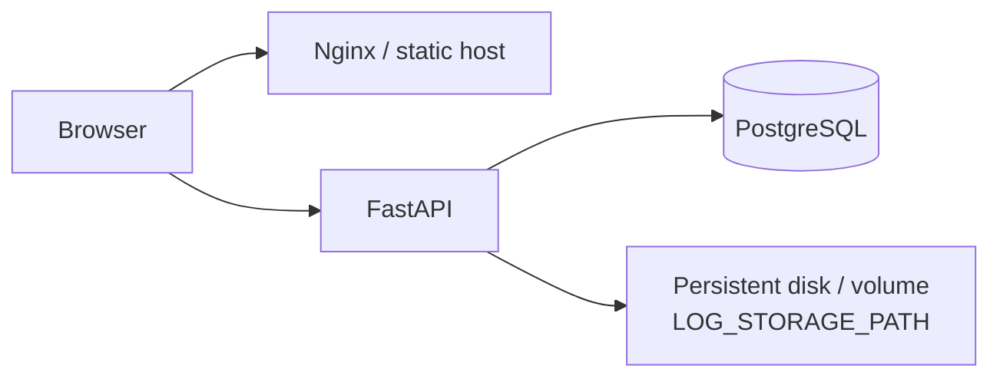

# Deployment Guide

PulseTrace is designed as a **modular monolith**: React SPA, FastAPI API, PostgreSQL, and filesystem log storage (volume-mounted in production).

## Recommended architecture



Suitable platforms: **Railway**, **Render**, **Fly.io**, or a single VPS with Docker Compose. Avoid splitting into microservices for this portfolio scope.

## Prerequisites

- PostgreSQL 16+
- Persistent disk for `LOG_STORAGE_PATH` (uploaded log files)
- HTTPS termination (reverse proxy or platform TLS)
- Secrets: `JWT_SECRET_KEY` (≥32 random bytes), `POSTGRES_PASSWORD`, production `DATABASE_URL`

## Environment variables

See [`.env.example`](../.env.example). Production highlights:

| Variable | Purpose |
|----------|---------|
| `APP_ENV=production` | Enables production checks and sanitized errors |
| `JWT_SECRET_KEY` | Sign access tokens |
| `DATABASE_URL` | Postgres connection |
| `BACKEND_CORS_ORIGINS` | **Exact** frontend origin(s), comma-separated |
| `AUTH_COOKIE_SECURE=true` | Required when using HTTPS + cookies |
| `LOG_STORAGE_PATH` | Writable path with persistent volume |
| `VITE_API_BASE_URL` | Public API URL (frontend build-time) |

## Local development vs production

| Mode | Command / notes |
|------|-----------------|
| Dev DB only | `docker compose up -d` — host port **5433** recommended on Windows |
| Dev API | `uvicorn app.main:app --reload` from `backend/` |
| Dev UI | `npm run dev` from `frontend/` |
| Prod-like stack | `docker compose -f docker-compose.prod.yml up --build` |
| **Isolated prod QA** | `docker-compose.prod.qa.yml` + `deploy/pulsetrace-prod-qa.env` (see [PRODUCTION_DOCKER_VERIFICATION.md](PRODUCTION_DOCKER_VERIFICATION.md)) |

**Never** run `docker compose down -v` — it removes the `pulsetrace_pgdata` volume.

## Backend deployment steps

1. Provision PostgreSQL; set `DATABASE_URL`.
2. Mount persistent volume at `/app/data/uploads` (or set `LOG_STORAGE_PATH`).
3. Build `backend/Dockerfile`; entrypoint runs `alembic upgrade head` then uvicorn.
4. Configure health check: `GET /api/v1/health`.
5. Set `BACKEND_CORS_ORIGINS` to the SPA origin.

## Frontend deployment steps

1. **Same-origin (recommended for Docker Compose):** build with `VITE_API_BASE_URL=` (empty). Nginx proxies `/api/` to the backend service (see `frontend/nginx.conf`).
2. **Split origin:** build with `VITE_API_BASE_URL=https://api.yourdomain.com` and set `BACKEND_CORS_ORIGINS` to the SPA origin.
3. Serve `dist/` via nginx (`try_files` for SPA refresh).
4. With HTTPS, set `AUTH_COOKIE_SECURE=true` and matching `BACKEND_CORS_ORIGINS`.

## Migrations

```bash
cd backend && alembic upgrade head
alembic current   # verify head d7e8f9a0b1c2
```

## Verification checklist

- Health endpoint returns `database: connected`
- Register/login works
- Upload persists after container restart (same volume)
- Analysis and RCA complete without Ollama

## Costs (indicative, 2025–2026)

- **Render/Railway free tiers:** limited hours, sleep on idle; Postgres add-on often paid after trial.
- **Small VPS (~$5–12/mo):** predictable; you manage backups and TLS.
- **Object storage:** optional future; filesystem on attached disk is simplest.

No deployment URL is listed here until a production instance is verified manually.